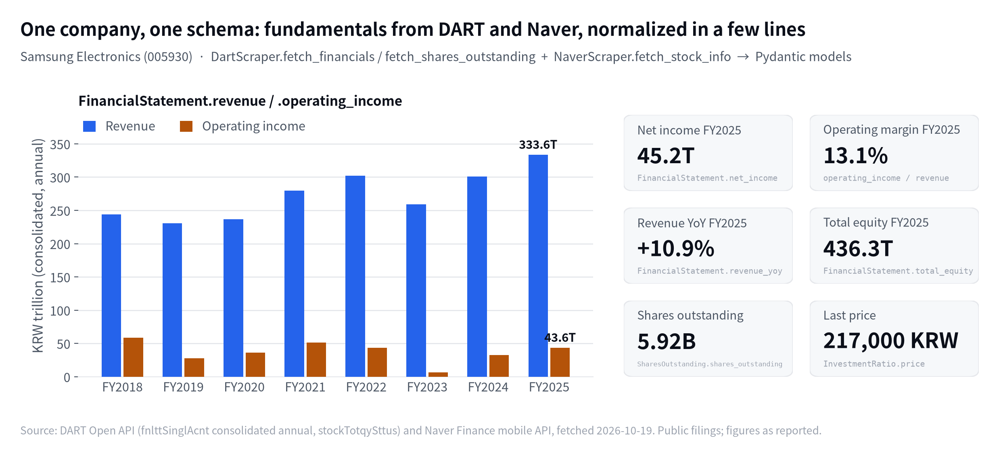

<div align="center">

<picture>
  <source media="(prefers-color-scheme: dark)" srcset="docs/images/brand/wordmark-dark.svg">
  
</picture>

# krx-fundamentals-client

**A Python library for Korean corporate fundamentals from DART, KRX and Naver as Pydantic models**

Install with one pip line; no server, cache or scheduler — each call queries the source directly.

[](https://github.com/younghwan91/krx-fundamentals-client/actions/workflows/ci.yml)
[](https://www.python.org/downloads/)
[](LICENSE)

[Guide (KO)](docs/guide.md) · [Comparison (KO)](docs/comparison.md) · [Architecture (KO)](docs/architecture.md) · [Examples](examples/) · [한국어](README.md)

</div>

One terminal line, no install and no API key: compare Korean stocks side by side by name or 6-digit code.

```bash
uvx --from git+https://github.com/younghwan91/krx-fundamentals-client krx-fundamentals 삼성전자 SK하이닉스 현대차 KB금융
```

```text
                     삼성전자       SK하이닉스           현대차           KB금융
                       005930           000660           005380           105560
────────────────────────────────────────────────────────────────────────────────
시장                    KOSPI            KOSPI            KOSPI            KOSPI
현재가              171,500원      1,055,000원        259,500원        145,500원
시가총액      1,002조 6,368억    745조 6,730억     52조 7,996억     51조 6,071억
PER                    5.39배           4.03배           9.07배           8.69배
PBR                    1.85배           2.43배           0.58배           0.84배
EPS                  31,809원        261,625원         28,621원         16,744원
BPS                  92,903원        433,826원        443,872원        172,316원
배당수익률              0.97%            0.28%            3.85%            3.00%
외국인소진율           45.84%           49.25%           23.88%           78.10%
52주 위치     ███░░░░░░░  26%  ██░░░░░░░░  21%  ░░░░░░░░░░   3%  ███░░░░░░░  34%

출처: 네이버 증권 · 투자 판단의 근거가 아닌 참고용 수치입니다.
```

<sub>Real output from 2026-11-27 (labels are in Korean). Reorder columns with <code>--sort per</code> (or <code>pbr</code>, <code>dividend</code>, <code>cap</code>); add <code>--json</code> for <code>InvestmentRatio</code> JSON. Without <a href="https://docs.astral.sh/uv/">uv</a>, <code>pip install</code> and run <code>krx-fundamentals 005930</code>.</sub>

In code it's three lines:

```python
# pip install git+https://github.com/younghwan91/krx-fundamentals-client
import asyncio
from krx_fundamentals_client import NaverScraper
print(asyncio.run(NaverScraper().fetch_stock_info("005930")))
```

More verified snippets (batch statements and debt ratio, screening, dividend history, analyst consensus, point-in-time share counts) are in the [Korean README](README.md#사용-예).

<picture>
  <source media="(prefers-color-scheme: dark)" srcset="docs/images/hero-dark.png">
  
</picture>

<p align="center"><sub>Live library output for Samsung Electronics FY2018–FY2025 consolidated statements (<code>fetch_financials</code>), dividends (<code>fetch_dividends</code>), and Naver ratios (<code>NaverScraper.fetch_stock_info</code>) (<a href="docs/images/hero-data.json">hero-data.json</a>).</sub></p>

## Quick start

Not on PyPI yet; install directly from git:

```bash
pip install git+https://github.com/younghwan91/krx-fundamentals-client
```

Get a free DART API key at [opendart.fss.or.kr](https://opendart.fss.or.kr) and fetch eight years of Samsung Electronics (`005930`) statements:

```python
import asyncio
from krx_fundamentals_client import DartScraper

async def main():
    dart = DartScraper(api_key="...")
    try:
        company = await dart.fetch_company("005930")
        print(company.name, company.ceo)
        for year in range(2018, 2026):
            fs = await dart.fetch_financials("005930", year)   # annual report, consolidated first (separate as fallback)
            if fs:
                print(year, f"revenue {fs.revenue:,.0f}", f"operating income {fs.operating_income:,.0f}")
    finally:
        await dart.close()

asyncio.run(main())
```

Running this prints the company name, CEO, and annual revenue and operating income. More runnable scripts live in [`examples/`](examples/).

## What it does

| Source | Class | Returns | Unit of collection | Auth |
|---|---|---|---|---|
| [DART OpenAPI](https://opendart.fss.or.kr) | `DartScraper` | Company profile, financial statements (annual, half, quarterly), shares outstanding, dividends, major shareholders, executives | Per ticker; statements also via `fetch_financials_batch`, up to 100 tickers per call | API key (free) |
| [Naver Finance](https://m.stock.naver.com) | `NaverScraper` | One `InvestmentRatio`: price, market cap, PER, PBR, EPS, BPS, dividend yield, volume, 52-week high/low, foreign ownership (measured 2026-10). Accounting ratios such as ROE and debt ratio stay `None` | Per ticker; `fetch_batch` for many | None |
| [KRX Information Data System](http://data.krx.co.kr) | `KrxScraper` | PER, PBR, market cap, sectors | Whole-market bulk CSV | None (currently blocked) |

- **Unified Pydantic models:** Import `Company`, `FinancialStatement`, `SharesOutstanding`, `InvestmentRatio`, `Dividend`, `Shareholder`, `Executive`, and `SectorOverview` directly from `krx_fundamentals_client` ([`models/schemas.py`](src/krx_fundamentals_client/models/schemas.py)).
- **Screening and ranking:** `screen_stocks` and `rank_stocks` (`RankingMetric`) are pure functions that filter and sort a `list[InvestmentRatio]` in place.
- **Lightweight, zero-server client:** Four dependencies (`httpx`, `beautifulsoup4`, `lxml`, `pydantic`); state and storage belong to the caller.

## Why it is built this way

- **A library, not a server:** FastAPI, cache and scheduler were removed in favor of a client library, matching [kiwoom-client](https://github.com/younghwan91/kiwoom-client) and [krx-news-client](https://github.com/younghwan91/krx-news-client).
- **Explicit failure semantics:** A spent DART daily quota raises `DartQuotaExceededError`, while a missing filing returns `None`. Pass an `on_status` callback to receive raw DART status codes (013, 010, 800, 900) without changing the return type.
- **Blocked paths documented openly:** The KRX scraper's silent empty list is not hidden; [docs/krx-blocked.md](docs/krx-blocked.md) traces it through the code.

## Caveats

- **KRX path blocked (measured 2026-08):** KRX put a login in front of its endpoints and `KrxScraper` returns an empty list without raising. Use `NaverScraper` for per-ticker price and valuation ratios ([docs/krx-blocked.md](docs/krx-blocked.md)).
- **Optional numeric fields:** When a source does not provide an item, it stays `None` rather than being invented.
- **DART `corp_code` cache:** The first call downloads the full mapping once and caches it on the instance for 24 hours, so reuse one scraper across tickers.

## Docs

| Doc | What's inside |
|---|---|
| [docs/guide.md](docs/guide.md) | Batch calls, key rotation, screening/ranking, structure diagram, dev commands (Korean) |
| [docs/comparison.md](docs/comparison.md) | Versus calling OpenDART directly, pykrx and FinanceDataReader, measured 2026-11 (Korean) |
| [docs/architecture.md](docs/architecture.md) | Scraper structure, ranking/screening, DART call order (Korean) |
| [docs/krx-blocked.md](docs/krx-blocked.md) | Code walkthrough of the KRX block (Korean) |
| [`examples/`](examples/) | Basic usage, screening, portfolio examples |

## Related projects

| Repo | What it is |
|---|---|
| [fin-checkup](https://github.com/younghwan91/fin-checkup) | The same DART statements as a site: 17 metrics as traffic lights, no code needed ([open it](https://younghwan91.github.io/fin-checkup/)). |
| [krx-news-client](https://github.com/younghwan91/krx-news-client) | DART filings and Toss Securities news in one schema, as a Python client. |
| [kiwoom-client](https://github.com/younghwan91/kiwoom-client) | Kiwoom REST API client for quotes and orders; pair it with this library for fundamentals. |

## Contributing & Support

- Report bugs, ask questions, or suggest features in [GitHub Issues](https://github.com/younghwan91/krx-fundamentals-client/issues).
- Author: **Younghwan Chae** · [GitHub @younghwan91](https://github.com/younghwan91) · [LinkedIn](https://www.linkedin.com/in/younghwan-chae/)

## License

[Apache-2.0](LICENSE)
