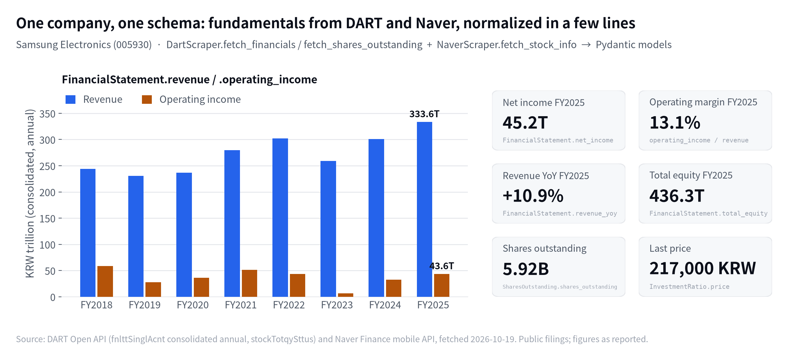

<div align="center">

<picture>
  <source media="(prefers-color-scheme: dark)" srcset="docs/images/brand/wordmark-dark.svg">
  
</picture>

# krx-fundamentals-client

**국내 기업 펀더멘탈을 DART·KRX·네이버에서 모아 Pydantic 모델로 돌려주는 Python 라이브러리**

서버·캐시·스케줄러 없이 pip 한 줄로 설치해 호출할 때마다 소스에 직접 요청합니다.

[](https://github.com/younghwan91/krx-fundamentals-client/actions/workflows/ci.yml)
[](https://www.python.org/downloads/)
[](LICENSE)

[사용 가이드](docs/guide.md) · [다른 방법과 비교](docs/comparison.md) · [아키텍처](docs/architecture.md) · [예제](examples/) · [English](README.en.md)

</div>

설치도, API 키도 없이 터미널 한 줄로 종목을 나란히 비교합니다. 종목명이나 6자리 코드를 넣으면 됩니다.

```bash
uvx --from git+https://github.com/younghwan91/krx-fundamentals-client krx-fundamentals 삼성전자 SK하이닉스 현대차 KB금융
```

```text
                     삼성전자       SK하이닉스           현대차           KB금융
                       005930           000660           005380           105560
────────────────────────────────────────────────────────────────────────────────
시장                    KOSPI            KOSPI            KOSPI            KOSPI
현재가              171,500원      1,055,000원        259,500원        145,500원
시가총액      1,002조 6,368억    745조 6,730억     52조 7,996억     51조 6,071억
PER                    5.39배           4.03배           9.07배           8.69배
PBR                    1.85배           2.43배           0.58배           0.84배
EPS                  31,809원        261,625원         28,621원         16,744원
BPS                  92,903원        433,826원        443,872원        172,316원
배당수익률              0.97%            0.28%            3.85%            3.00%
외국인소진율           45.84%           49.25%           23.88%           78.10%
52주 위치     ███░░░░░░░  26%  ██░░░░░░░░  21%  ░░░░░░░░░░   3%  ███░░░░░░░  34%

출처: 네이버 증권 · 투자 판단의 근거가 아닌 참고용 수치입니다.
```

<sub>2026-11-27 실제 출력입니다. <code>--json</code>을 붙이면 같은 내용을 <code>InvestmentRatio</code> JSON으로 출력합니다. <a href="https://docs.astral.sh/uv/">uv</a>가 없다면 <code>pip install</code> 후 <code>krx-fundamentals 삼성전자</code>로 실행합니다.</sub>

코드에서는 3줄이면 됩니다.

```python
# pip install git+https://github.com/younghwan91/krx-fundamentals-client
import asyncio
from krx_fundamentals_client import NaverScraper
print(asyncio.run(NaverScraper().fetch_stock_info("005930")))
```

<picture>
  <source media="(prefers-color-scheme: dark)" srcset="docs/images/hero-dark.png">
  
</picture>

<p align="center"><sub>삼성전자 FY2018~FY2025 연결 재무제표(<code>fetch_financials</code>), 주당배당금(<code>fetch_dividends</code>), 네이버 투자지표(<code>NaverScraper.fetch_stock_info</code>) 실제 호출 결과입니다 (<a href="docs/images/hero-data.json">hero-data.json</a>).</sub></p>

## 빠른 시작

PyPI에는 아직 올라와 있지 않아 git에서 바로 설치합니다.

```bash
pip install git+https://github.com/younghwan91/krx-fundamentals-client
```

[opendart.fss.or.kr](https://opendart.fss.or.kr)에서 무료 DART API 키를 발급받아 삼성전자(`005930`) 8개년 재무제표를 조회합니다.

```python
import asyncio
from krx_fundamentals_client import DartScraper

async def main():
    dart = DartScraper(api_key="...")
    try:
        company = await dart.fetch_company("005930")
        print(company.name, company.ceo)
        for year in range(2018, 2026):
            fs = await dart.fetch_financials("005930", year)   # 사업보고서, 연결 우선(없으면 개별)
            if fs:
                print(year, f"매출 {fs.revenue:,.0f}", f"영업이익 {fs.operating_income:,.0f}")
    finally:
        await dart.close()

asyncio.run(main())
```

실행하면 기업명·대표자명과 함께 연도별 매출·영업이익을 출력합니다. 다른 예제는 [`examples/`](examples/)에 있습니다.

## 무엇을 하나

| 소스 | 클래스 | 돌려주는 것 | 수집 단위 | 인증 |
|-----|-------|-----------|----------|------|
| [DART OpenAPI](https://opendart.fss.or.kr) | `DartScraper` | 기업개황, 재무제표(연간·반기·분기), 발행주식수, 배당, 대주주, 임원 | 종목 단위. 재무제표는 `fetch_financials_batch`로 최대 100종목/호출 | API 키 (무료) |
| [네이버 금융](https://m.stock.naver.com) | `NaverScraper` | `InvestmentRatio` 한 건: 현재가·시가총액·PER·PBR·EPS·BPS·배당수익률·거래량·52주 고저·외국인소진율 (2026-10 실측). ROE·부채비율 같은 재무비율은 주지 않아 `None` | 종목 단위, `fetch_batch`로 여러 종목 | 불필요 |
| [KRX 정보데이터시스템](http://data.krx.co.kr) | `KrxScraper` | PER·PBR·시가총액·섹터 | 시장 전체 벌크 CSV | 불필요 (현재 차단) |

- **단일 Pydantic 모델:** `Company`, `FinancialStatement`, `SharesOutstanding`, `InvestmentRatio`, `Dividend`, `Shareholder`, `Executive`, `SectorOverview`를 `krx_fundamentals_client`에서 바로 import합니다([`models/schemas.py`](src/krx_fundamentals_client/models/schemas.py)).
- **스크리닝·랭킹:** `screen_stocks`와 `rank_stocks`(`RankingMetric`)는 `list[InvestmentRatio]`를 받아 그 자리에서 거르고 정렬하는 순수 함수입니다.
- **서버 없는 경량 클라이언트:** 의존성은 `httpx`, `beautifulsoup4`, `lxml`, `pydantic` 넷뿐이며 상태와 저장은 호출자가 맡습니다.

## 사용 예

아래 코드는 모두 2026-11-26에 실제로 실행했고, 출력도 그때 받은 값입니다. DART 예제는 환경변수 `DART_API_KEY`에 키를 넣고 실행합니다.

<details open>
<summary><b>여러 종목 재무제표를 한 번에 받아 부채비율 계산하기</b> (DART <code>fnlttMultiAcnt</code>, 최대 100종목/호출)</summary>

```python
import asyncio, os
from krx_fundamentals_client import DartScraper

async def main():
    dart = DartScraper(api_key=os.environ["DART_API_KEY"])
    try:
        fs_by_ticker = await dart.fetch_financials_batch(["005930", "000660", "035420"], year=2025)
        for ticker, fs in fs_by_ticker.items():
            if fs and fs.total_equity:
                debt_ratio = fs.total_liabilities / fs.total_equity * 100
                print(ticker, f"부채비율 {debt_ratio:.1f}%", f"매출 YoY {fs.revenue_yoy:+.1f}%")
    finally:
        await dart.close()

asyncio.run(main())
```

```text
005930 부채비율 29.9% 매출 YoY +10.9%
000660 부채비율 45.9% 매출 YoY +46.8%
035420 부채비율 41.9% 매출 YoY +12.1%
```

</details>

<details>
<summary><b>PBR·배당수익률로 거르고 PER 낮은 순으로 정렬하기</b> (네이버, 키 불필요)</summary>

`screen_stocks`의 `market`에는 `Market` enum 또는 대소문자 구분 없는 문자열(예: `"KOSPI"`)을 사용할 수 있으며, 지원하지 않는 값은 `ValueError`를 일으키고 시장 필터를 지정하면 시장 정보가 없는 종목은 제외됩니다.

```python
import asyncio
from krx_fundamentals_client import NaverScraper, RankingMetric, rank_stocks, screen_stocks

async def main():
    naver = NaverScraper()
    try:
        ratios = await naver.fetch_batch(["005930", "000660", "035420", "005380", "105560", "055550"])
    finally:
        await naver.close()
    cheap = screen_stocks(ratios, pbr_max=1.0, dividend_yield_min=3.0)
    print("PBR 1 이하·배당수익률 3% 이상:", [r.name for r in cheap])
    for r in rank_stocks(ratios, RankingMetric.PER, ascending=True)[:3]:
        print(r.name, r.per)

asyncio.run(main())
```

```text
PBR 1 이하·배당수익률 3% 이상: ['현대차', '신한지주']
SK하이닉스 3.88
삼성전자 5.25
신한지주 7.64
```

</details>

<details>
<summary><b>배당 이력 보기</b> (DART <code>alotMatter</code>)</summary>

```python
import asyncio, os
from krx_fundamentals_client import DartScraper

async def main():
    dart = DartScraper(api_key=os.environ["DART_API_KEY"])
    try:
        for year in (2023, 2024, 2025):
            d = await dart.fetch_dividends("005930", year)
            if d:
                print(year, f"주당배당금 {d.dividend_per_share:,.0f}원", f"배당성향 {d.payout_ratio}%")
    finally:
        await dart.close()

asyncio.run(main())
```

```text
2023 주당배당금 1,444원 배당성향 67.8%
2024 주당배당금 1,446원 배당성향 29.2%
2025 주당배당금 1,668원 배당성향 25.1%
```

</details>

<details>
<summary><b>애널리스트 컨센서스와 추정 EPS 받기</b> (네이버, 키 불필요)</summary>

```python
import asyncio
from krx_fundamentals_client.scrapers.naver import NaverConsensusScraper

async def main():
    naver = NaverConsensusScraper()
    try:
        target, opinion, as_of = await naver.fetch_consensus("005930")
        fwd_eps, prev_eps, est_year = await naver.fetch_estimate("005930")
        print(f"목표주가 평균 {target:,.0f}원 · 투자의견 {opinion} ({as_of})")
        print(f"{est_year} 추정 EPS {fwd_eps:,.0f} / 직전 실적 EPS {prev_eps:,.0f}")
    finally:
        await naver.close()

asyncio.run(main())
```

```text
목표주가 평균 458,182원 · 투자의견 4.0 (2026-11-24)
2026 추정 EPS 45,515 / 직전 실적 EPS 6,564
```

</details>

<details>
<summary><b>발행주식수를 기준일·공시일과 함께 받기</b> (백테스트에서 미래 정보가 섞이지 않게)</summary>

```python
import asyncio, os
from krx_fundamentals_client import DartScraper

async def main():
    dart = DartScraper(api_key=os.environ["DART_API_KEY"])
    try:
        s = await dart.fetch_shares_outstanding("005930", 2025)
        print(f"{s.shares_outstanding:,}주 · 기준일 {s.stlm_dt} · 공시일 {s.knowledge_date}")
    finally:
        await dart.close()

asyncio.run(main())
```

```text
5,919,637,922주 · 기준일 2025-12-31 · 공시일 20260310
```

</details>

OpenDART를 직접 부를 때, pykrx·FinanceDataReader를 쓸 때와 무엇이 다른지는 [docs/comparison.md](docs/comparison.md)에 실측과 함께 정리했습니다.

## 왜 이렇게 만들었나

- **서버가 아닌 라이브러리:** FastAPI·캐시·스케줄러를 걷어내고 라이브러리로 바꿨습니다([kiwoom-client](https://github.com/younghwan91/kiwoom-client), [krx-news-client](https://github.com/younghwan91/krx-news-client)와 같은 구조입니다).
- **실패를 구분하는 설계:** DART 일한도 소진은 `DartQuotaExceededError` 예외로, 공시 없음은 `None`으로 돌려줍니다. `on_status` 콜백을 넘기면 반환 타입을 바꾸지 않고 DART status 코드(013, 010, 800, 900)를 받아볼 수 있습니다.
- **막힌 경로의 투명한 공개:** KRX 경로가 조용히 빈 리스트를 내는 현상을 숨기지 않고 [docs/krx-blocked.md](docs/krx-blocked.md)에 코드 추적까지 기록했습니다.

## 주의할 점

- **KRX 경로 차단(2026-08 실측):** KRX가 로그인을 걸어 `KrxScraper`가 예외 없이 빈 리스트를 돌려줍니다. 시세·PER·PBR 같은 종목별 투자지표는 `NaverScraper`를 사용하세요([docs/krx-blocked.md](docs/krx-blocked.md)).
- **누락 수치 처리:** 소스가 항목을 주지 않으면 값을 지어내지 않고 `None`으로 비워 둡니다.
- **DART `corp_code` 캐시:** 첫 호출에서 전체 매핑을 내려받아 인스턴스에 24시간 캐시하므로 여러 종목을 조회할 때는 인스턴스를 재사용하세요.

## 문서

| 문서 | 내용 |
|---|---|
| [docs/guide.md](docs/guide.md) | 배치 조회, 키 순환, 스크리닝·랭킹, 구조 다이어그램, 개발 명령 |
| [docs/comparison.md](docs/comparison.md) | OpenDART 직접 호출·pykrx·FinanceDataReader와 비교 (2026-11 실측) |
| [docs/architecture.md](docs/architecture.md) | 스크레이퍼 구조, 랭킹·스크리닝, DART 호출 순서 |
| [docs/krx-blocked.md](docs/krx-blocked.md) | KRX 차단 코드 추적 |
| [`examples/`](examples/) | 기본 사용·스크리닝·포트폴리오 예제 |

## 같이 쓰면 좋은 것

| 레포 | 한 줄 설명 |
|---|---|
| [fin-checkup](https://github.com/younghwan91/fin-checkup) | 같은 DART 재무제표를 지표 17개 신호등으로 읽어 주는 사이트입니다. 코드 없이 보고 싶을 때 [바로 열어 보세요](https://younghwan91.github.io/fin-checkup/). |
| [krx-news-client](https://github.com/younghwan91/krx-news-client) | DART 공시와 토스증권 뉴스를 한 스키마로 받는 Python 클라이언트입니다. |
| [kiwoom-client](https://github.com/younghwan91/kiwoom-client) | 키움 REST API 클라이언트입니다. 시세·주문은 여기서, 펀더멘탈은 이 라이브러리에서 받습니다. |

## 기여 및 문의

- 기여 방법(개발 환경·테스트·커밋 규칙)은 [CONTRIBUTING.md](CONTRIBUTING.md), 처음이라면 [good first issue](https://github.com/younghwan91/krx-fundamentals-client/issues?q=is%3Aissue+is%3Aopen+label%3A%22good+first+issue%22)부터 보세요.
- 버그 제보, 질문, 기능 제안은 [GitHub Issues](https://github.com/younghwan91/krx-fundamentals-client/issues)에 남겨주세요.
- 만든 사람: **채영환 (Younghwan Chae)** · [GitHub @younghwan91](https://github.com/younghwan91) · [LinkedIn](https://www.linkedin.com/in/younghwan-chae/)

## 라이선스

[Apache-2.0](LICENSE)
