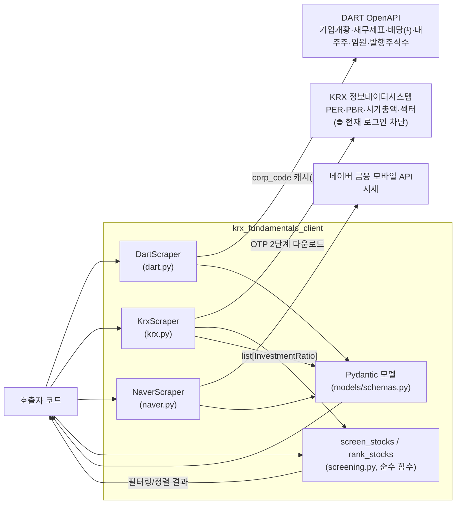

# krx-fundamentals-client

**국내 기업 펀더멘탈을 DART·KRX·네이버에서 모아 Pydantic 모델로 돌려주는 Python 라이브러리 — 서버 없이 pip 한 줄.**

[](https://github.com/younghwan91/krx-fundamentals-client/actions/workflows/ci.yml)
[](https://www.python.org/downloads/)
[](https://github.com/younghwan91/krx-fundamentals-client/blob/main/LICENSE)
[](https://www.linkedin.com/in/younghwan-chae/)

<picture>
  <source media="(prefers-color-scheme: dark)" srcset="docs/images/hero-dark.png">
  
</picture>

[English](README.en.md)

- 위 그림의 숫자는 전부 라이브러리 호출값과 그 비율(영업이익률)이다 — 삼성전자 연결 재무제표 FY2018~FY2025 8개년을 `fetch_financials` 로 받은 그대로([hero-data.json](docs/images/hero-data.json)).
- 상시 서버·캐시·스케줄러가 없다. 의존성은 httpx·beautifulsoup4·lxml·pydantic 넷뿐이고, 호출할 때마다 소스에 직접 요청한다.
- DART 일한도 소진은 `DartQuotaExceededError` 로 던진다 — "데이터 없음"과 섞이지 않는다.

> ⛔ **KRX 경로는 막혀 있다 (2026-08 실측).** KRX 가 로그인을 걸어 `KrxScraper` 가 예외 없이 빈 리스트를 돌려준다.
> DART 경로는 영향 없고, 시세(현재가)는 `NaverScraper` 로 받는다. 추적: [docs/krx-blocked.md](docs/krx-blocked.md).

## 빠른 시작

PyPI 에는 아직 없다. git 에서 바로 설치한다:

```bash
pip install git+https://github.com/younghwan91/krx-fundamentals-client
```

DART API 키는 [opendart.fss.or.kr](https://opendart.fss.or.kr) 에서 무료로 발급한다. 한 종목의 재무제표 8개년(히어로 그림 그대로):

```python
import asyncio
from krx_fundamentals_client import DartScraper

async def main():
    dart = DartScraper(api_key="...")
    try:
        company = await dart.fetch_company("005930")
        print(company.name, company.ceo)
        for year in range(2018, 2026):
            fs = await dart.fetch_financials("005930", year)   # 사업보고서, 연결 우선(없으면 개별)
            if fs:
                print(year, f"매출 {fs.revenue:,.0f}", f"영업이익 {fs.operating_income:,.0f}")
    finally:
        await dart.close()

asyncio.run(main())
```

바로 돌려볼 수 있는 전체 스크립트는 [`examples/`](examples/) 에 있다.

## 무엇을 하나

| 소스 | 클래스 | 돌려주는 것 | 수집 단위 | 인증 |
|-----|-------|-----------|----------|------|
| [DART OpenAPI](https://opendart.fss.or.kr) | `DartScraper` | 기업개황, 재무제표(연간·반기·분기), 발행주식수, 배당¹, 대주주, 임원 | 종목 단위. 재무제표는 `fetch_financials_batch` 로 최대 100종목/호출 | API 키 (무료) |
| [네이버 금융](https://m.stock.naver.com) | `NaverScraper` | `InvestmentRatio` 한 건. 현재 응답에서는 현재가만 채워진다(2026-10 실측); PER·PBR·EPS·BPS·배당수익률 등 나머지 필드는 `None` | 종목 단위, `fetch_batch` 로 여러 종목 | 불필요 |
| [KRX 정보데이터시스템](http://data.krx.co.kr) | `KrxScraper` | PER·PBR·시가총액·섹터 | 시장 전체 벌크 CSV | 불필요 (⛔ 현재 차단) |

¹ `fetch_dividends` 는 현재 DART 엔드포인트가 status 101 을 돌려줘 `None` 을 반환한다(2026-10 실측).

- **응답 모델**: `Company`, `FinancialStatement`, `SharesOutstanding`, `InvestmentRatio`, `Dividend`, `Shareholder`, `Executive`, `SectorOverview`. 전부 Pydantic 이고 `krx_fundamentals_client` 에서 바로 import 한다. 필드 정의는 [`models/schemas.py`](src/krx_fundamentals_client/models/schemas.py).
- **스크리닝·랭킹**: `screen_stocks`(PER·PBR·ROE·배당수익률·시가총액 범위 필터), `rank_stocks`(`RankingMetric` 기준 정렬). `list[InvestmentRatio]` 를 넘기면 그 자리에서 계산하는 순수 함수다.
- 각 모델의 수치 필드는 `None` 일 수 있다 — 소스가 그 항목을 주지 않으면 값을 지어내지 않고 비워 둔다.

## 왜 이렇게 만들었나

- **서버가 아니다.** FastAPI·캐시·스케줄러를 걷어내고 라이브러리로 바꿨다. 상태와 저장은 호출자 몫이다. [kiwoom-client](https://github.com/younghwan91/kiwoom-client)·[krx-news-client](https://github.com/younghwan91/krx-news-client) 와 같은 모양이다.
- **실패를 구분한다.** 한도 소진은 예외, 공시 없음은 `None`. 재무제표 호출에 `on_status` 콜백을 넘기면 DART status 코드(013 공시 없음 / 010·800·900 실패)를 반환 타입을 바꾸지 않고 받아볼 수 있다.
- **막힌 것은 막혔다고 적는다.** KRX 경로가 조용히 빈 리스트를 내는 문제는 숨기지 않고 [docs/krx-blocked.md](docs/krx-blocked.md) 에 코드 추적까지 남겼다.

## 더 쓰기

여러 종목의 재무제표를 한 번에 (DART `fnlttMultiAcnt`, 최대 100종목/호출):

```python
financials = await dart.fetch_financials_batch(["005930", "000660", "035420"], year=2025)
for ticker, fs in financials.items():
    if fs is not None:
        print(ticker, fs.revenue, fs.net_income)
```

키 여러 개를 순환할 때는 `DartQuotaExceededError` 를 잡아 다음 키로 넘어간다:

```python
from krx_fundamentals_client import DartQuotaExceededError, DartScraper

async def fetch_with_rotation(tickers, keys):
    for key in keys:
        scraper = DartScraper(api_key=key)
        try:
            return [await scraper.fetch_company(t) for t in tickers]
        except DartQuotaExceededError:
            continue
        finally:
            await scraper.close()
    raise RuntimeError("모든 키가 일한도를 소진했다")
```

스크리닝·랭킹 — PER·PBR 이 채워진 `list[InvestmentRatio]` 가 있을 때. 지금은 `NaverScraper` 가 현재가만 채우고 KRX 는 막혀 있어, 아래 결과는 빈 리스트다:

```python
from krx_fundamentals_client import NaverScraper, RankingMetric, rank_stocks, screen_stocks

naver = NaverScraper()
try:
    ratios = await naver.fetch_batch(["005930", "000660", "035420", "005380"])  # 현재는 price 만 채워진다
    value_stocks = screen_stocks(ratios, per_max=15.0, pbr_max=1.2)
    top_by_pbr = rank_stocks(ratios, RankingMetric.PBR)
finally:
    await naver.close()
```

## 구조



DART 상세 조회는 모두 `corp_code` 가 필요하다. 첫 호출에서 전체 매핑을 한 번 내려받아 인스턴스에 24시간 캐시하므로, 여러 종목을 볼 때는 스크레이퍼 인스턴스를 재사용한다.

## 개발

```bash
uv sync --extra dev
uv run pytest                        # 테스트 (HTTP 는 pytest-httpx 목)
uv run ruff check src/ tests/        # 린트
```

## 문서

- [docs/architecture.md](docs/architecture.md) — 스크레이퍼 구조, 랭킹/스크리닝, DART 호출 순서
- [docs/krx-blocked.md](docs/krx-blocked.md) — KRX 차단 코드 추적
- [`examples/`](examples/) — 기본 사용·스크리닝·포트폴리오 예제

## 라이선스

Apache-2.0 ([LICENSE](LICENSE))

## 만든 사람

**채영환 (Younghwan Chae)** · [GitHub @younghwan91](https://github.com/younghwan91) · [LinkedIn](https://www.linkedin.com/in/younghwan-chae/)

## 기여 및 이슈 제보

- 🐛 버그 제보, 질문, 기능 제안: [GitHub Issues](https://github.com/younghwan91/krx-fundamentals-client/issues)
- 📈 업데이트 소식: [팔로우 @younghwan91](https://github.com/younghwan91)


## 관련 프로젝트 — 오픈소스 퀀트 스택

한국·미국 주식과 암호화폐를 아우르는 오픈소스 스택입니다. 각 저장소는 독립적으로 쓸 수 있습니다.

| 축 | 프로젝트 | 설명 |
|---|---|---|
| 🇰🇷 한국 주식 | **[kiwoom-client](https://github.com/younghwan91/kiwoom-client)** | 키움증권 REST API Python 라이브러리 — 국내주식 엔드포인트 전수·실시간 WebSocket, sync + async (`pip install kiwoom-client`) |
| 🇰🇷 한국 주식 | **[krx-news-client](https://github.com/younghwan91/krx-news-client)** | 한국 주식 뉴스·공시를 한 스키마로 내주는 Python 클라이언트 라이브러리 (DART + 토스증권) |
| 🇰🇷 한국 주식 | **[krx-quant-core](https://github.com/younghwan91/krx-quant-core)** | 한국 주식 퀀트 시스템 공통 Python 코어 — KRX 호가·가격제한폭·세션 규칙, 시행일별 거래세 비용모델, 키움 주문 가드, DART 중대공시 위험 분류, 체결 시뮬레이션, Deflated Sharpe·purged CV 통계 |
| 🇰🇷 한국 주식 | **[fin-checkup](https://github.com/younghwan91/fin-checkup)** | 관심종목 위험 공시 텔레그램 알림 + DART·SEC 재무 건강검진 — 측정값과 사실만 전달한다 |
| 🇰🇷 한국 주식 | **[quant-airflow](https://github.com/younghwan91/quant-airflow)** | 시세·수급·실적을 TimescaleDB 로 수집하는 Airflow 파이프라인 — 상장폐지 종목까지 담아 생존편향을 막는다 |
| 🇰🇷 한국 주식 | **[swing-it](https://github.com/younghwan91/swing-it)** | 코스피·코스닥 알파 심사 프레임워크 — 개별 트레이드 분포로 판정하고 랜덤 음성대조·purged CV·Deflated Sharpe 를 CI 가드레일로 강제 |
| 🇺🇸 미국 주식 | **[portfolio-research](https://github.com/younghwan91/portfolio-research)** | 미국주식 팩터 엔진 — point-in-time·생존편향 보정 데이터 위에서 walk-forward 를 Deflated Sharpe·PBO 로 게이팅하고 ETF 전술배분도 같은 관문을 지난다 |
| 🇺🇸 미국 주식 | **[macro-sector-agent](https://github.com/younghwan91/macro-sector-agent)** | 하향식 미국 산업 사이클 리서치 — \"어느 산업이 잊혔나\"를 묻고 기계는 제외만 한다 |
| 🇺🇸 미국 주식 | **[automated-stock-trading-systems](https://github.com/younghwan91/automated-stock-trading-systems)** | Bensdorp 의 7개 비상관 트레이딩 시스템 백테스터 (교육용 재구현) |
| ₿ 암호화폐 | **[binance-quant-engine](https://github.com/younghwan91/binance-quant-engine)** | 암호화폐 선물 백테스트·실행 엔진 — 룩어헤드 0, 백테스트↔실거래 일체화 |
| ₿ 암호화폐 | **[crypto-quant-insights](https://github.com/younghwan91/crypto-quant-insights)** | 실거래 선물 시스템을 검증하며 나온 차트 연구 노트 — 폭락 스트레스 테스트·Kelly 레버리지·체결 간극 |

